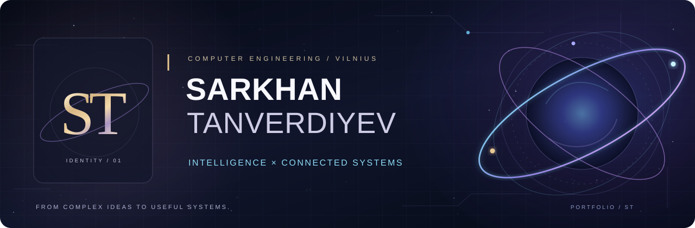

<div align="center">
  

  <h3>Computer Engineering MSc Student &nbsp;·&nbsp; AI &amp; IoT Explorer &nbsp;·&nbsp; Systems Thinker</h3>

  <p>
    <b>Vilnius, Lithuania</b> &nbsp; · &nbsp;
    <a href="https://github.com/SarxanT?tab=repositories">Explore projects</a> &nbsp; · &nbsp;
    <a href="#-selected-projects">Selected work</a> &nbsp; · &nbsp;
    <a href="#-background">Background</a>
  </p>
</div>

---

## ◈ About me

I'm **Sarkhan Tanverdiyev**, a Computer Engineering master's student in Vilnius with a background in **telecommunications, programming, and satellite operations**. I'm interested in where **AI, software, and connected devices** meet real-world problems—and in the process of turning an idea into a system that people can actually use.

My work and studies connect two perspectives: **understanding requirements and workflows** and **exploring how to build the technology behind them**. From business tools to IoT experiments, I enjoy learning by making things clearer, smarter, and more practical.

> **My approach:** Understand the problem. Design the system. Learn by building.

## ◈ What I'm exploring

```text
                        S T  /  CURRENT SIGNAL
 ────────────────────────────────────────────────────────────────
  FIELD               FOCUS
  ──────────────────  ───────────────────────────────────────────
  Intelligent systems  AI-assisted tools and practical automation
  Connected systems    ESP32, sensors, IoT and cloud data flows
  Software & data      C++ · Python · C# · SQL
  Product thinking     Requirements, process analysis, workflows
 ────────────────────────────────────────────────────────────────
```

## ◈ Selected projects

### Public GitHub repositories

| Repository | What you'll find | Verification |
| :--- | :--- | :--- |
| **[C++ Programming Exercises](https://github.com/SarxanT/cpp-programming-exercises)** | Six C++17 practice programs covering classes, inheritance, containers, and problem-solving | Compilation and basic GitHub Actions smoke checks |
| **[SQL Database Exercises](https://github.com/SarxanT/sql-database-exercises)** | Six Microsoft SQL Server / T-SQL exercises covering table design, filtering, joins, and aggregation | Scripts documented; database-specific runtime testing pending |

<sub>Next in the portfolio: Arduino laboratories and ESP32-based motor-condition monitoring. I’ll link them here after reviewing their security and testing.</sub>

### Product and process projects

*The following are project contributions described in my CV; they are not public-source repositories.*

| Project | My contribution |
| :--- | :--- |
| **Zero-Based Organizational Design Tool** | Business requirements and full-stack development work for strategic organizational analysis |
| **AI CV Screener** | Supported development of an AI-assisted recruitment-screening tool |
| **Org-Chart Request Tool** | Requirements analysis and workflow optimization for digitizing organization-chart requests |
| **Team Vacation Tool** | Defined functional requirements for easier leave planning and team coordination |

## ◈ Tools and technologies

**Programming and data**  
`Python` · `C++` · `C#` · `SQL` · `Object-oriented programming`

**Connected systems**  
`ESP32` · `Arduino` · `IoT sensors` · `Networking` · `ThingSpeak` · `Wokwi`

**Systems and product work**  
`Business requirements` · `Process design` · `Workflow analysis` · `AI-assisted development`

<sub>These reflect my educational background, project exposure, and current learning areas—not a claim of expert proficiency in every tool.</sub>

## ◈ Background

| Journey | Highlights |
| :--- | :--- |
| **MSc · Computer Engineering** | Vilnius Gediminas Technical University (VGTU), 2025–2027 · AI, software engineering, IoT, data-driven technologies |
| **BSc · Telecommunication Engineering** | Azerbaijan State Oil and Industry University (ASOIU), 2020–2024 · networks, digital systems, signal processing |
| **Software Development** | STEP IT Academy, 2024 · Python, C++, C#, SQL and OOP foundations |
| **Satellite Operations Intern** | Azerbaijan State Cosmic Agency · exposure to satellite operations and communication systems |
| **Chairman · Innovations Club** | ASOIU, 2024 · coordinated innovation initiatives and student teams |

## ◈ Looking ahead

I want to keep connecting **intelligent software, physical systems, and thoughtful product design**. My next milestones are publishing reproducible IoT projects, improving code quality, and experimenting with automation and AI-driven applications.

I value clear documentation and real testing. Some repositories are historical learning exercises; I'll label their limitations honestly rather than presenting them as finished production systems.

<div align="center">
  
  <sub>Made with intention · <a href="https://github.com/SarxanT">github.com/SarxanT</a></sub>
</div>
